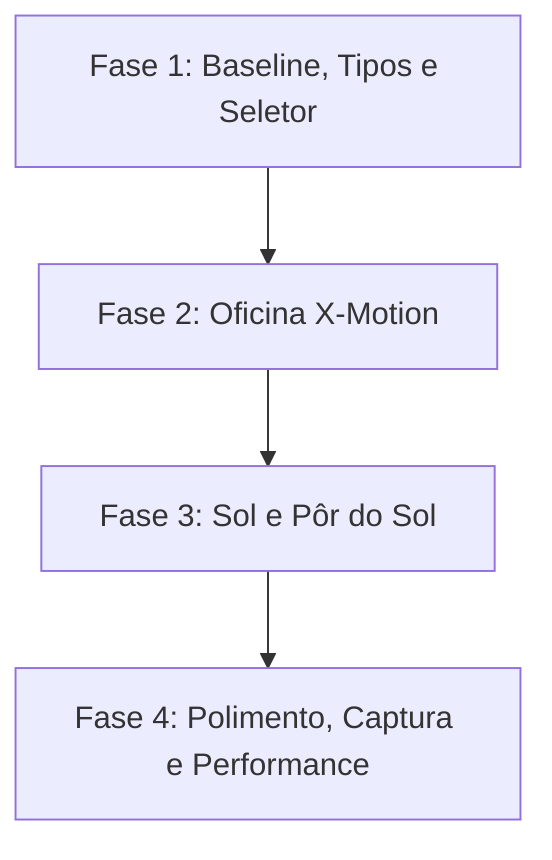

# X-Flow — Plano de Implementação: Cenários de Ambiente no Simulador 3D

**Projeto:** X-Flow (CRM/OS para Oficina de PPF, Car Wrap e Detailing)  
**Entidade:** X-Motion (`x_motion.wrap`)  
**Data:** 25 de outubro de 2026  
**Versão:** 1.1 — Revisão técnica após análise de viabilidade  
**Ficheiro de referência:** `X-Flow_Plano_Cenarios_Simulador_3D.md`  
**Imagens de referência:** `public/oficina/` (11 fotografias reais do estúdio/baia de entrega da X-Motion)

> Esta revisão mantém o objetivo de negócio da versão 1.0 e corrige os pontos que impediam a implementação direta: reflexos do néon, oclusão da parede e do teto nas vistas 360º/topo, sombras exteriores, transição de ambiente, exportação PNG e critérios de aceitação.

---

## 1. Justificação e Valor de Negócio

Na comercialização e aplicação de películas de proteção de pintura (**PPF**) e personalização vinílica (**Car Wrap**), **a iluminação é o fator decisivo de venda**.

A perceção visual dos acabamentos automóveis varia drasticamente consoante a fonte de luz:

1. **PPF Gloss vs. PPF Satin/Mate:**
   * Em estúdio neutro, o acabamento mate pode parecer subtil.
   * Sob **sol direto exterior**, o cliente comprova como o PPF Satin quebra as reflexões especulares e vinca as linhas de design do carro sem brilhos cegantes.
2. **Películas Metálicas, Pérolas e Efeitos Especiais:**
   * Cores com pigmentação metálica ou iridescente beneficiam de luz pontual intensa para revelar profundidade e contraste.
   * **Nota de âmbito:** o simulador 3D atual aplica metallic e clearcoat, mas não implementa flakes 3D. Esta fase melhora a leitura do metallic; a criação de flakes geométricos fica para uma fase própria.
3. **Identidade e Autoridade X-Motion:**
   * Apresentar o carro simulado dentro da **própria baia de entrega da X-Motion** — com a parede preta, o néon iluminado de assinatura e as luzes de inspeção no teto — conecta imediatamente a proposta digital à oficina física real que o cliente conhece do Instagram (`@x_motion.wrap`).

---

## 2. Decomposição do Espaço Real da Oficina (`public/oficina`)

Com base nas fotografias de entregas reais da X-Motion, o cenário de assinatura é decomposto nos seguintes elementos físicos:

```text
                  [ TETO: Calhas Lineares de LED Duplas 5500K ]
                                  \       /
                                   \     /  (Reflexos paralelos na carroçaria)
                                    v   v
    +-------------------------------------------------------------------------+
    |                                                                         |
    |                         [ NEON X-MOTION ]                               |
    |                   /\      /\       (Laranja âmbar #ff7a00)              |
    |                  /  \    /  \      (Branco frio #ffffff)                |
    |                  \   \  /   /                                           |
    |                   \   \/   /       Lettering: "xmotion"                 |
    |                                                                         |
    |                      PAREDE PRETA MATE (#0b0d0e)                        |
    |                                                                         |
    +-------------------------------------------------------------------------+
                         [ VIATURA 3D EM EXPOSIÇÃO ]
                                     |
    ===========================================================================
              PAVIMENTO DE BETÃO INDUSTRIAL AFAGADO (Cinza Médio #4e5358)
    ===========================================================================
```

### 2.1. O Néon X-Motion de Parede

* **Geometria:** marca X-Motion com traços entrelaçados e lettering `xmotion`. A geometria final deve seguir o vetor oficial da marca; as fotografias de Instagram servem de referência de escala e cor, não como asset de produção.
* **Cor e Emissão:**
  * Segmentos interiores em âmbar/laranja quente (`#ff7a00` / `#f59e0b`).
  * Arestas exteriores e lettering em branco luminoso (`#ffffff`).
* **Comportamento no Three.js:**
  * O material emissivo do néon **não ilumina nem aparece automaticamente no environment map**.
  * Para iluminação local: adicionar uma luz pontual/retangular de baixa intensidade junto à parede.
  * Para reflexo na tinta e no vidro: duplicar o néon como `Lightformer` dentro do `<Environment>` ou fazer um bake pontual com `CubeCamera`.
  * Para brilho: usar planos aditivos em camadas ou sprites. Bloom via pós-processamento fica fora do âmbito inicial por custo em mobile.

### 2.2. O Sistema de Iluminação Técnica de Teto

* **Disposição:** 3 filas de calhas duplas de LED brancas (5500K), ou seja, 6 réguas emissivas, montadas em ângulo simétrico.
* **Reflexos:** criam as assinaturas de linhas paralelas brancas que correm ao longo das curvas das portas, capô e embaladeiras.
* **Implementação:** as calhas são `Lightformer` no environment map e barras finas emissivas na cena. Não é necessário um teto sólido completo; se existir, deve ser interior e não pode ocluir a vista “Topo”.
* **Iluminação de preenchimento:** acrescentar uma luz ambiente suave e uma luz frontal difusa para evitar que o carro fique apenas com reflexos e perca leitura de volume.

### 2.3. O Chão Industrial Afagado

* **Material:** betão afagado cinzento (`roughness: 0.38`, `metalness: 0.05`), com `envMapIntensity` calibrado para receber os reflexos do ambiente.
* **Geometria:** plano contínuo, sem costuras visíveis no enquadramento das câmaras. O chão atual não existe como mesh no cenário; será criado nesta fase.
* **Sombra:** no cenário oficina, `ContactShadows` suave sob os pneus. No exterior, usar sombra direcional real; não sobrepor as duas sem necessidade.

---

## 3. Catálogo de Cenários a Implementar

O simulador 3D passará a suportar 4 ambientes selecionáveis:

| ID | Nome do Cenário | Ícone Lucide | Ambiente e Iluminação | Utilidade Comercial |
|---|---|---|:---:|---|---|
| `xmotion-workshop` | **Oficina X-Motion** | `Warehouse` | Parede preta mate, néon X-Motion aceso, calhas de LED e piso de betão | **Cenário de assinatura:** entrega real, reconhecimento de marca e linhas de inspeção nítidas. |
| `outdoor-sun` | **Luz do Dia / Sol** | `Sun` | Sol direto de céu limpo (6500K), sombras nítidas e reflexo pontual intenso | Revelar contraste metálico, cores vivas e o efeito antirreflexo do PPF Mate. |
| `golden-hour` | **Pôr do Sol** | `Sunset` | Luz solar rasante quente (3200K), tons dourados e sombras longas | Realçar vincos musculados, wrap acetinado e apelo estético para supercarros. |
| `dark-studio` | **Estúdio Dark Neutro** | `Aperture` | Fundo neutro escuro com softboxes perimetrais difusas | Inspeção técnica de ângulos de corte e wrap parcial sem distrações. |

**Default proposto:** `dark-studio` na primeira entrega, para preservar o comportamento atual. `xmotion-workshop` passa a default apenas depois de validada a fidelidade visual e a performance em mobile.

---

## 4. Arquitetura Técnica no X-Flow

### 4.1. Estrutura de Ficheiros

```text
src/
├── lib/
│   └── car-environments.ts         <-- Presets tipados, metadados e configuração de luz/chão/sombra
└── components/xflow/simulator/
    ├── CarStudio3D.tsx             <-- Integração do cenário, câmara, captura e UI
    ├── environments/
    │   ├── EnvironmentStage.tsx    <-- Orquestra chão, parede, luzes e ambiente ativo
    │   ├── XMotionWorkshopEnv.tsx  <-- Parede, néon, calhas de LED e piso da oficina
    │   ├── OutdoorSunEnv.tsx       <-- Sol direcional, céu e chão exterior
    │   ├── GoldenHourEnv.tsx       <-- Variante rasante/quente do cenário exterior
    │   └── StudioDarkEnv.tsx       <-- Configuração atual isolada como preset
    └── EnvironmentSelector.tsx     <-- Chips em desktop e seletor compacto em mobile
```

`car-environments.ts` deve permanecer puro e testável: sem JSX, sem componentes React e sem emojis. O ícone é guardado como chave (`"workshop"`, `"sun"`, `"sunset"`, `"studio"`) e mapeado para Lucide na UI.

### 4.2. Eficiência e Desempenho (Sem HDRI Pesado)

* **Zero ficheiros HDR externos:** manter a abordagem procedural com `<Environment>` + `<Lightformer>`.
* **Um ambiente montado de cada vez:** trocar com `key={environmentId}` e desmontar o anterior para libertar render targets.
* **Resolução do environment map:** 256 px em desktop; 128 px em mobile ou modo balanced.
* **DPR:** manter `[1, 2]` como máximo, mas limitar a 1.5–1.75 em mobile se o teste de performance exigir.
* **Geometria leve:** néon com tubos finos ou planos recortados; calhas com barras emissivas finas; sem bloom pesado na primeira versão.
* **Sem dependências novas:** não introduzir `@react-three/postprocessing` nem HDRI sem decisão explícita.

### 4.3. Néon, Reflexos e Iluminação

O ponto crítico é separar três coisas:

1. **Néon visível:** malha emissiva na cena (`MeshBasicMaterial` com `toneMapped={false}` ou material emissivo controlado).
2. **Néon que ilumina:** luz pontual/retangular próxima da parede, com intensidade baixa e cor âmbar/branca.
3. **Néon que se reflete:** `Lightformer` equivalente dentro do `<Environment>`, com a mesma posição, forma e cor.

Sem o ponto 3, o néon pode aparecer na parede mas não na tinta. A solução preferida é duplicar a geometria simplificada como `Lightformer`; a alternativa é um `CubeCamera` com bake único, mais caro e mais complexo.

O chão e a tinta recebem o reflexo através do environment map. O `ContactShadows` não participa neste reflexo.

### 4.4. Câmara, Parede e Teto

As câmaras atuais estão em:

* `rear`: `[-0.4, 1.4, -6.6]`
* `top`: `[0.2, 7.4, 0.6]`

A parede proposta em `z = -4.5` e um teto sólido colidem com estas vistas. Regras obrigatórias:

* **Parede:** ocultar quando a câmara passa para trás da parede (`z < -3.9` aproximadamente). Usar `visible` por limiar, não opacidade contínua, para evitar problemas de transparência e ordenação. O fundo escuro do cenário preenche o vazio.
* **Teto:** não criar um plano sólido completo. Usar apenas as calhas e uma estrutura fina; ocultar o grupo do teto quando a câmara estiver acima do seu plano (`y > 4.6` aproximadamente).
* **Vista Topo:** deve mostrar o carro e o chão, nunca a face superior do teto.
* **Vista Traseira:** deve mostrar o carro e a parede, nunca o verso da parede.
* **360º:** continua disponível; o utilizador pode rodar atrás da parede, mas vê o fundo escuro e o chão, não geometria invertida.
* **Escala:** o modelo mais comprido tem 5,92 m (RAM 1500 TRX). Validar a folga da parede e o enquadramento com este modelo antes de fechar as medidas.

Se a parede for escondida por limiar, a transição deve ser instantânea ou coberta por um fade de 100–150 ms. Evitar `transparent` + `opacity` contínuos num plano grande.

### 4.5. Sombras e Chão

* **Oficina e estúdio:** `ContactShadows` com `scale` e `blur` atuais, ajustados ao piso.
* **Exterior:** ativar sombras reais no canvas e usar um `directionalLight` com `castShadow`; o chão recebe a sombra; o carro projeta-a.
* **Qualidade:** shadow map de 1024 px em desktop e 512 px em mobile; câmara de sombra justa para evitar mapas enormes.
* **Mobile:** se a sombra direcional comprometer os 30 FPS, cair para `ContactShadows` e manter o sol apenas como iluminação/reflexo.
* **Chão exterior:** plano amplo com horizonte neutral; evitar que o bordo do plano apareça no enquadramento.

### 4.6. Transição Entre Ambientes

O `<Environment>` do drei faz bake e não interpola mapas nativamente. A transição segura é:

1. Interpolar fundo, exposição e intensidades de luz durante 120–180 ms.
2. Fazer um crossfade visual curto com overlay escuro.
3. Trocar o `<Environment key={environmentId}>` no ponto médio.
4. Remover o overlay.
5. Garantir que o environment anterior é desmontado e os recursos são libertados.

Não prometer “lerp” do environment map em si; prometer transição sem flicker.

### 4.7. Calibração de Cor

Cada cenário deve ter exposição e balanço de branco próprios. Antes de aceitar as cores:

* Comparar a mesma película (branco, preto, vermelho e metallic) nos quatro ambientes.
* Verificar que o néon não tinge toda a carroçaria de laranja.
* Verificar que o sol não estoura os brancos nem apaga o PPF Satin.
* Manter `ACESFilmicToneMapping` e ajustar `toneMappingExposure` por cenário, se necessário.

---

## 5. Interface do Utilizador (UI/UX)

### 5.1. Barra de Controlo de Cenários

Localização:

* **Desktop/tablet:** imediatamente abaixo da barra de vistas de câmara.
* **Mobile:** seletor compacto (dropdown nativo estilizado ou carril horizontal curto) para não reduzir a área do carro. Não acrescentar uma segunda fila de chips por baixo da barra de câmara em ecrãs estreitos.

Regras:

* Usar ícones Lucide, nunca emojis.
* Botão ativo com contorno/fundo dourado X-Motion (`#d3a548`).
* `aria-pressed`, foco visível e navegação por teclado.
* Rótulo “Cenário” visível em desktop; em mobile, `aria-label` explícito.
* Não esconder o carril de modelos existente nem a barra “Zona”.

### 5.2. Exportação de Imagem (Download / Partilha com Cliente)

A função `capture()` existente será atualizada para:

* Preencher primeiro o fundo com a cor opaca do cenário ativo (o canvas atual tem `alpha: true`; sem isto, o PNG pode sair transparente).
* Desenhar a imagem WebGL por cima.
* Incluir o nome da viatura, película, cobertura e cenário.
* Manter a atribuição CC BY do modelo e da película no rodapé.
* Garantir que o texto cabe na largura; usar duas linhas ou truncagem com reticências se necessário.
* Exportar em PNG legível no WhatsApp, com o logótipo X-Motion apenas se existir asset aprovado.

O cenário tem de estar no canvas WebGL (cor de fundo, chão e paredes), não apenas em CSS/DOM; caso contrário, não entra na exportação.

---

## 6. Fases de Execução e Entregáveis



### Fase 1: Baseline, Presets e Seletor

* Extrair o ambiente atual para `StudioDarkEnv.tsx` sem alterar o aspeto.
* Criar `CAR_ENVIRONMENTS` com `EnvironmentId` tipado, nome, ícone, cor de fundo, exposição, chão, sombra e parâmetros de luz.
* Integrar `environmentId` em `CarStudio3D.tsx`.
* Criar `EnvironmentSelector` com chips em desktop e seletor compacto em mobile.
* Atualizar `capture()` com nome do cenário e fundo opaco.
* Testes unitários dos presets e smoke test visual.

**Saída:** o estúdio atual continua visualmente igual, mas já é um preset selecionável.

### Fase 2: Oficina X-Motion

* Criar parede preta mate e piso de betão.
* Adicionar as 6 calhas de LED no teto sem plano sólido oclusivo.
* Ocultar parede/teto nas vistas traseira/topo e validar 360º.
* Construir o néon a partir do vetor aprovado.
* Adicionar luz local + `Lightformer` de reflexo + glow aditivo.
* Calibrar reflexos na tinta e no vidro com BMW, Huracán, Rolls e RAM.
* Manter `ContactShadows` no piso.

**Saída:** cenário de assinatura funcional, sem oclusões e com néon refletido.

### Fase 3: Sol e Pôr do Sol

* Criar sol direcional com sombras reais e chão exterior.
* Adicionar variante golden hour com ângulo rasante e temperatura quente.
* Implementar modo de qualidade desktop/mobile.
* Validar brancos, PPF Satin e metallic.
* Testar troca de ambiente sem flicker e sem fuga de memoria.

**Saída:** quatro ambientes completos e com performance controlada.

### Fase 4: Polimento, UI e Testes

* Acessibilidade do seletor (`aria-pressed`, teclado, foco).
* Teste de exportação PNG com fundo e rodapé.
* Matriz visual: 4 ambientes × modelos representativos.
* Verificação em 390, 1024, 1280 e 1536 px.
* `npm run typecheck`, `npm run lint`, `npm run test` e `npm run build`.
* Revisão de performance com o painel do browser.

---

## 7. Riscos e Mitigações

| Risco | Impacto | Mitigação |
|---|---|---|
| Néon não refletir na tinta | Alto | Duplicar como `Lightformer` dentro do `Environment`; validar com tinta metálica. |
| Parede/teto bloquear Traseira/Topo | Alto | Ocultar por limiar de câmara; sem teto sólido; testar 360º. |
| Sombras direcionais pesadas em mobile | Alto | Shadow map reduzido, modo balanced e fallback para `ContactShadows`. |
| Sem vetor oficial do logótipo | Médio | Pedir SVG; até lá usar marca simplificada aprovada, nunca traçar da foto. |
| PNG com fundo transparente | Médio | Fundo WebGL opaco + `fillRect` antes do `drawImage`. |
| Flicker na troca de ambiente | Médio | Overlay de crossfade e troca keyed no ponto médio. |
| Promessa de flakes não cumprida | Médio | Deixar flakes fora do âmbito e documentar que só há metallic/clearcoat. |
| UI demasiado densa em mobile | Médio | Seletor compacto em mobile; medir área útil do canvas. |

---

## 8. Critérios de Aceitação (DoD)

1. [ ] **Fidelidade Visual:** a Oficina X-Motion reproduz a atmosfera das fotos (parede preta, néon visível e refletido, calhas de LED e piso cinzento), sem geometria invertida ou oclusões.
2. [ ] **Câmara:** Frente, 3/4, Esquerda, Direita, Traseira, Topo e rotação 360º funcionam nos quatro cenários; parede e teto nunca tapam o carro.
3. [ ] **Desempenho:** 60 FPS em desktop e mínimo 30 FPS estável em mobile, medidos no browser; troca de ambiente sem bloqueio perceptível e sem erros na consola.
4. [ ] **Sem Dependências Pesadas:** nenhum HDR de dezenas de megabytes; sem pós-processamento novo sem aprovação.
5. [ ] **Compatibilidade:** os 13 modelos 3D atuais funcionam com os quatro ambientes, em especial o RAM 1500 TRX (5,92 m) e o Rolls-Royce Ghost (5,55 m), com todos os tipos de película e wrap parcial.
6. [ ] **Exportação:** PNG opaco, com viatura, película, cobertura, cenário e atribuição, legível no WhatsApp.
7. [ ] **UI e Acessibilidade:** seletor com ícones Lucide, sem emojis, `aria-pressed`, teclado e foco visível; sem perda significativa de área do carro em mobile.
8. [ ] **Testes e Build:** `npm run typecheck`, `npm run lint`, `npm run test` e `npm run build` passam; presets têm testes unitários; há verificação visual dos quatro cenários.
9. [ ] **Default:** `dark-studio` mantém-se até a Oficina X-Motion ser aprovada em fidelidade e performance.

---

## 9. Fora do Âmbito / Pressupostos

* Não serão implementados flakes 3D nesta fase; apenas iluminação e contraste metallic.
* Não serão usados ficheiros HDRI externos.
* Não será adicionado bloom/pós-processamento sem decisão explícita.
* As fotografias de `public/oficina/` são referência, não assets de produção.
* O logótipo néon requer vetor oficial da X-Motion ou aprovação de uma versão simplificada.
* O catálogo 3D atual tem 13 modelos; Porsche 911, Ferrari 296 e Tesla Model 3 são referências de negócio/frota, não modelos disponíveis no simulador.
* A seleção de cenário não precisa de persistência em base de dados nesta entrega.
